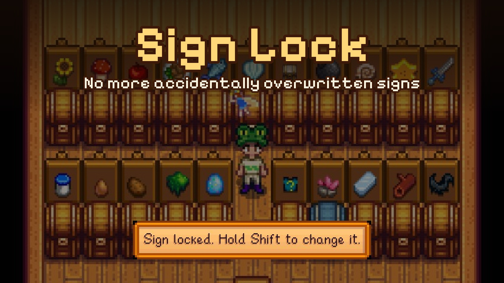
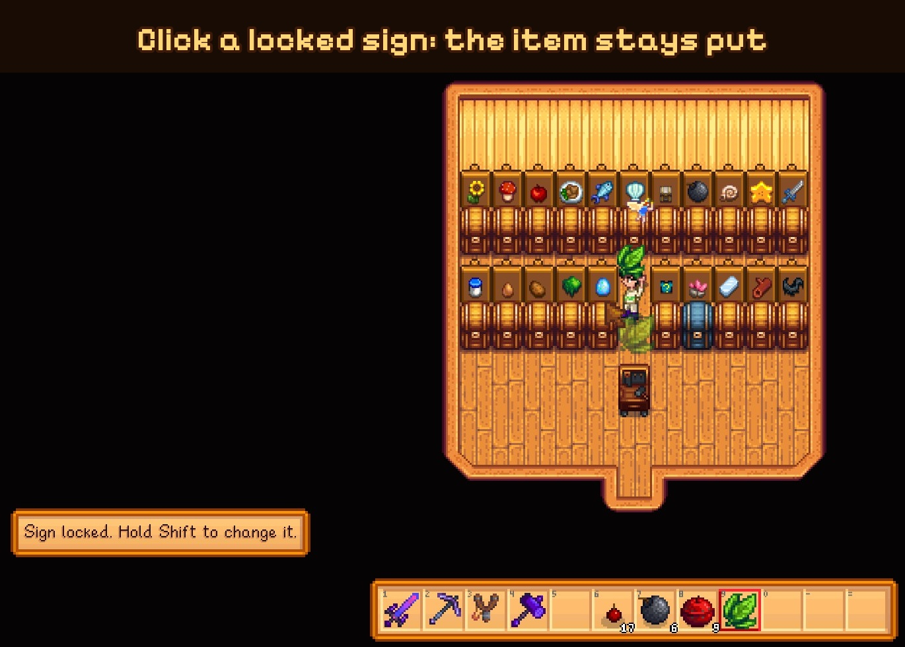

# Sign Lock



A small [SMAPI](https://smapi.io/) mod for Stardew Valley 1.6.

Signs show whatever item you click them with, so it's easy to overwrite one by accident, for example when it sits right next to a chest. With this mod, a sign that already shows an item ignores clicks. Hold **Shift** while clicking to change it on purpose.

Empty signs work like before, and picking a sign up with a tool still works too.



## Install

1. Install [SMAPI](https://smapi.io/).
2. Download the latest version from [Nexus Mods](https://www.nexusmods.com/stardewvalley/mods/54057) or [GitHub](https://github.com/Malenyaaa/stardew-mods/releases) and unzip it into your `Mods` folder.
3. Start the game through SMAPI.

## Config

Edit `config.json` (created on first launch) or use [Generic Mod Config Menu](https://www.nexusmods.com/stardewvalley/mods/5098):

| Option | Default | What it does |
|---|---|---|
| `Enabled` | `true` | Turns the lock on or off. |
| `UnlockKey` | `LeftShift, RightShift` | Hold this while clicking a sign to change its item. Any [SMAPI keybind](https://stardewvalleywiki.com/Modding:Player_Guide/Key_Bindings) works, including controller buttons. |
| `ShowHint` | `true` | Shows a short message when a click was blocked. |

## Compatibility

- Stardew Valley 1.6+, SMAPI 4.0+
- Works in multiplayer. Each player only needs it if they want the lock for themselves.
- Translations: English, German.

## Building

Needs the .NET 6+ SDK. Build from the repo root, since the mod uses shared code from `Common`. The build uses [Pathoschild.Stardew.ModBuildConfig](https://www.nuget.org/packages/Pathoschild.Stardew.ModBuildConfig), which finds the game folder automatically (or set the `GamePath` environment variable).

```
dotnet build SignLock -c Release
```

## License

MIT
